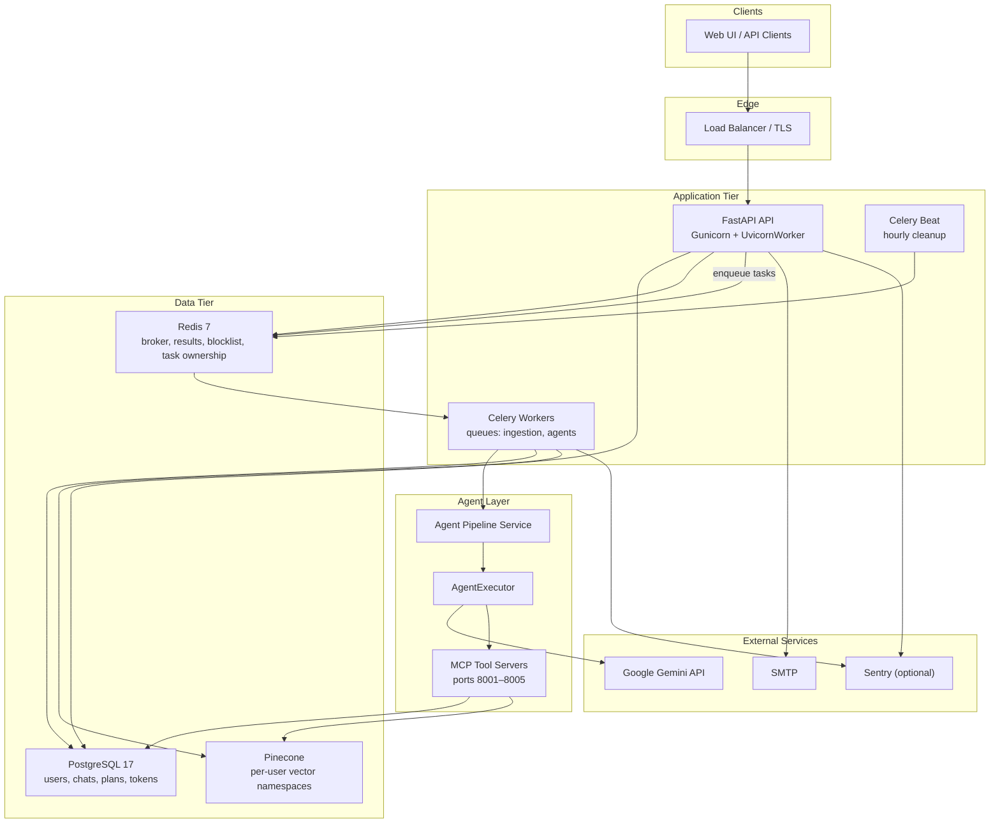

# Architecture

This document describes the system design of the MultiAgent Course Planner.

## Overview

The platform accepts course documents from users, indexes them in a per-user Pinecone namespace, and generates personalized study plans through a multi-agent pipeline orchestrated by Celery workers. The API is stateless; all persistent state lives in PostgreSQL and Pinecone.

## System Diagram



## Request Flows

### Registration and authentication

1. `POST /v1/register` creates a `User` record with bcrypt-hashed password.
2. `POST /v1/login` issues a JWT access token (15 min) and refresh token (7 days), persisted in `auth_tokens`.
3. `POST /v1/refresh` rotates the token pair; old refresh tokens are marked expired.
4. `POST /v1/logout` blocklists the access JWT in Redis and revokes the refresh token.
5. Protected routes use `get_user` dependency — validates JWT type, checks Redis blocklist, loads user from DB.

### Document upload and ingestion

```
POST /v1/upload
  → save files to data/{user_id}/
  → create Document records (status=pending)
  → enqueue ingest_documents Celery task
  → return 202 + task_id

Worker: ingest_documents
  → mark documents processing
  → chunk + embed via LangChain + Gemini
  → upsert to Pinecone (namespace = user_id)
  → update Document status (completed/failed)
```

### Study plan generation

```
POST /v1/chats          → create chat session
POST /v1/upload         → upload course materials
POST /v1/generate       → enqueue run_agent_pipeline task
GET  /v1/tasks/{id}     → poll task status

Worker: run_agent_pipeline
  → Planner: break topic into study_topics
  → Tutor: explain each topic (with RAG context from Pinecone)
  → Notes: create structured notes per topic
  → Critic: generate practice test
  → save StudyPlan + update ChatHistory
```

## Component Details

### API layer (`src/api/`)

| Module | Responsibility |
|--------|---------------|
| `app.py` | App factory, middleware, Prometheus, migrations on startup |
| `routes/auth.py` | Register, login, refresh, logout, /me |
| `routes/upload.py` | File upload with size limits and sanitization |
| `routes/generate.py` | Enqueue agent pipeline, poll task status |
| `routes/chat.py` | Chat CRUD |
| `routes/documents.py` | Document listing and status |
| `routes/study_plans.py` | Study plan listing and retrieval |
| `routes/health.py` | `/health` (liveness), `/ready` (DB + Redis + Pinecone) |
| `middleware.py` | Request ID, security headers, structured request logging |

### Authentication (`src/auth/`)

| Module | Responsibility |
|--------|---------------|
| `auth.py` | JWT validation, `get_user` FastAPI dependency |
| `token_service.py` | Issue, refresh, revoke tokens with DB persistence |
| `token_blocklist.py` | Redis-backed JWT revocation |
| `authorization.py` | User/run ownership validation for MCP tools |

### Worker layer (`src/worker/`)

| Queue | Tasks |
|-------|-------|
| `ingestion` | `ingest_documents` (autoretry, 3 max) |
| `agents` | `run_agent_pipeline` (autoretry, 3 max) |
| `notifications` | `send_welcome_email` |
| `maintenance` | `cleanup_temp_files` (hourly via beat) |

Task ownership is tracked in Redis so `GET /v1/tasks/{task_id}` only returns results to the owning user.

### Agent layer (`src/agents/`)

| Agent | Role | Key method |
|-------|------|------------|
| Planner | Decompose topic into study topics | `create_plan()` |
| Tutor | Explain topics with RAG context | `explain()` |
| Notes | Generate structured notes | `create_notes()` |
| Critic | Create practice test | `create_test()` |

`AgentExecutor` (`src/agents/agent_executor.py`) coordinates agent-to-agent messaging and logs each step to `agent_messages`. The default graph is defined in `src/agents/registry.py`.

LLM calls go through `src/agents/llm_client.py` (Google Gemini wrapper with token usage metrics).

### MCP tool servers (`src/mcp/`)

Each MCP server runs as a separate Docker container and exposes tools over HTTP:

| Server | Port | Tools |
|--------|------|-------|
| Orchestrator | 8001 | `get_user_history`, `create_plan` |
| Planner | 8002 | `save-plan`, `get_agent_conversation` |
| Tutor | 8003 | `search_documents`, `get_agent_conversation` |
| Critic | 8004 | `get_agent_conversation` |
| Notes | 8005 | `get_agent_conversation` |

All tools validate `user_id` and run ownership before accessing data.

### Data layer

**PostgreSQL tables:**

| Table | Purpose |
|-------|---------|
| `users` | Accounts with bcrypt passwords |
| `auth_tokens` | JWT pairs with expiry tracking |
| `documents` | Upload metadata and ingestion status |
| `chat_histories` | Per-user chat sessions (JSONB message arrays) |
| `study_plans` | Generated plans with notes and tests |
| `agent_runs` | Pipeline execution records |
| `agent_messages` | Agent-to-agent message log |

**Pinecone:**

- One index per environment (`DEFAULT_VECTOR_INDEX`)
- Per-user namespaces (`user_id` as namespace)
- Metadata filters ensure users only search their own documents

### Observability (`src/observability/`)

| Component | Details |
|-----------|---------|
| Logging | structlog JSON with `request_id`, `user_id`, `duration_ms`, `task_id` |
| Metrics | Prometheus `/metrics` — request latency, queue depth, pipeline duration, LLM tokens |
| Sentry | Optional via `SENTRY_DSN` — FastAPI, Celery, SQLAlchemy integrations |
| Health | `/health` (process up), `/ready` (dependencies reachable) |

## Security Model

- All data endpoints scope queries to the authenticated `user_id`
- JWT access tokens expire in 15 minutes; refresh tokens in 7 days with rotation
- Revoked tokens are blocklisted in Redis until natural expiry
- Upload filenames are sanitized; file size limits enforced (50 MB/file, 200 MB/request)
- Security headers (CSP, X-Frame-Options, etc.) on all responses
- Rate limiting via slowapi on login (10/min) and generate (20/min)
- Secrets via environment variables only (use a secret manager in production)

## Directory Structure

```
src/
├── api/              # FastAPI routes, middleware, app factory
├── auth/             # JWT, token service, authorization
├── agents/           # Agent implementations and executor
├── mcp/              # MCP tool server processes
├── database/         # DB session, ingestion, vector search
├── repositories/     # Data access layer
├── services/         # Agent pipeline orchestration
├── worker/           # Celery app, tasks, config
├── observability/    # Logging, metrics, Sentry
├── serializers/      # Pydantic request/response schemas
├── settings.py       # Environment-based configuration
└── core/models.py    # SQLAlchemy ORM models
```
