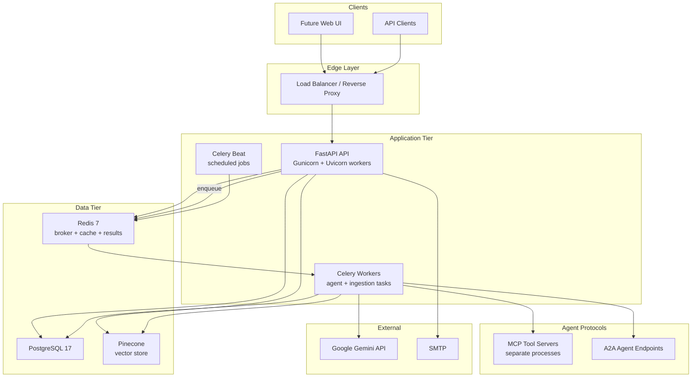
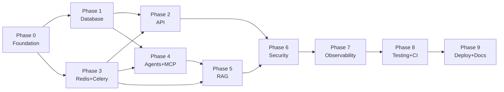

# Production Readiness Roadmap

A phased plan to take **MultiAgent-Course-Planner** from scaffold to production, including upgrades to **Python 3.12**, **PostgreSQL 17**, **Redis 7**, and **Celery 5.6**.

Each phase is designed to be completed and validated before moving to the next. Phases are ordered by dependency — later phases assume earlier ones are done.

---

## Current State Summary

| Area | Status |
|------|--------|
| Auth (register/login) | Partially working |
| Document upload → Pinecone | Working (PDF only) |
| Agent pipeline | Logic exists, not wired to API |
| MCP servers | Started inline, DB access bugs |
| A2A / AgentExecutor | Empty stubs |
| Docker | Config drift, missing files |
| Tests / CI | None |
| Migrations | `create_all()` only |
| Async jobs | None (blocking API calls) |

---

## Target Production Architecture



---

## Phase 0 — Foundation and Tooling

**Goal:** Establish a stable, reproducible development baseline before changing application logic.

### 0.1 — Repository structure and dependency management

- [x] Replace flat `requirements.txt` with **`pyproject.toml`** (or split `requirements/base.txt`, `dev.txt`, `prod.txt`)
- [x] Pin all dependency versions; use `pip-tools` or `uv` for lockfiles
- [x] Add **`.env.example`** documenting every required variable from `src/settings.py`
- [x] Add **`Makefile`** with targets: `install`, `lint`, `test`, `migrate`, `up`, `down`
- [x] Normalize all imports to a single style (`from src.` prefix everywhere)
- [x] Add `src/__init__.py` and package structure so `PYTHONPATH` is not fragile

**Deliverable:** `pip install -e ".[dev]"` works on a clean machine.

### 0.2 — Python 3.12 upgrade

- [x] Update `Dockerfile` base image: `python:3.12-slim`
- [x] Update `docker-compose.yml` build contexts
- [x] Verify compatibility of key packages on 3.12:
  - `google-adk`, `a2a-sdk`, `mcp[cli]`, `langchain-*`, `pinecone`
- [x] Add `requires-python = ">=3.12,<3.13"` in `pyproject.toml`
- [x] Run full import smoke test after upgrade

**Deliverable:** All modules import cleanly on Python 3.12.

### 0.3 — PostgreSQL 17 upgrade

- [x] Change `docker-compose.yml`: `image: postgres:17`
- [x] Update `DB_URL` format in `.env.example` for Postgres 17
- [x] Verify SQLAlchemy 2.x compatibility with Postgres 17
- [x] Add healthcheck: `pg_isready -U admin -d demo`

**Deliverable:** App connects to Postgres 17; tables create successfully.

### 0.4 — Docker and compose overhaul

Current issues to fix:

| Issue | Fix | Status |
|-------|-----|--------|
| `mcp_app` builds from `./src/core` (no Dockerfile) | Single root `Dockerfile` with multi-stage build | Done |
| `mcp_agents` runs missing `server.py` | MCP servers as separate compose services | Done |
| MCP servers started inside API process | Separate compose services per MCP server | Done |
| No healthchecks | Add for all services | Done |

Proposed `docker-compose.yml` services:

| Service | Image / Build | Port |
|---------|---------------|------|
| `db` | `postgres:17` | 5432 |
| `redis` | `redis:7-alpine` | 6379 |
| `api` | `Dockerfile` (api target) | 8000 |
| `worker` | `Dockerfile` (worker target) | — |
| `beat` | `Dockerfile` (worker target) | — |
| `mcp-orchestrator` | `Dockerfile` (mcp target) | 8001 |
| `mcp-planner` | `Dockerfile` (mcp target) | 8002 |
| `mcp-tutor` | `Dockerfile` (mcp target) | 8003 |
| `mcp-critic` | `Dockerfile` (mcp target) | 8004 |
| `mcp-notes` | `Dockerfile` (mcp target) | 8005 |

**Deliverable:** `docker compose up` starts all services without errors.

---

## Phase 1 — Database and Data Layer Hardening

**Goal:** Replace ad-hoc schema management with production-grade persistence.

### 1.1 — Alembic migrations

- [ ] Add `alembic` and initialize: `alembic init alembic`
- [ ] Point Alembic at `src/core/models.py` metadata
- [ ] Generate initial migration from current models
- [ ] Remove `Base.metadata.create_all()` from API startup; run migrations in entrypoint instead
- [ ] Add migration step to Docker entrypoint: `alembic upgrade head`

### 1.2 — Fix ORM model inconsistencies

| Bug | Location | Fix |
|-----|----------|-----|
| `ChatHistory` uses `history=[]` in API but model has `messages` | `api.py` `new_chat` | Align field names |
| `ChatHistory` missing `created_at` used in API | `api.py` | Add column or remove usage |
| `new_chat` passes `id=chat_id` but model has separate `id` and `chat_id` | `api.py` | Use correct PK/FK pattern |
| `StudyPlan` has `notes`/`test` but MCP uses `plan=` | `planner_server.py` | Align MCP tool with model |
| `AuthToken` model exists but login doesn't persist tokens | `auth.py` | Implement token storage + refresh |

### 1.3 — Database session management

- [ ] Create `src/database/session.py` with:
  - `get_db()` — FastAPI dependency (generator)
  - `get_db_session()` — context manager for non-FastAPI code (MCP, Celery)
- [ ] Fix all MCP tools to use `get_db_session()` instead of calling `get_db()` incorrectly
- [ ] Add connection pool settings: `pool_size=10`, `max_overflow=20`, `pool_pre_ping=True`

### 1.4 — Repository layer (optional but recommended)

- [ ] Add `src/repositories/` with typed query methods:
  - `UserRepository`, `ChatRepository`, `StudyPlanRepository`, `AgentRunRepository`
- [ ] Keeps MCP tools and API routes thin; centralizes query logic

**Deliverable:** `alembic upgrade head` creates a correct schema; all DB access uses proper sessions.

---

## Phase 2 — API Layer Production Hardening

**Goal:** Make the REST API complete, typed, and safe for external clients.

### 2.1 — Request/response schemas

- [ ] Complete `src/serializers/backend.py` with proper Pydantic v2 models:
  - `RegisterRequest`, `LoginRequest`, `TokenResponse`
  - `UploadResponse`, `GenerateRequest`, `GenerateResponse`
  - `ChatResponse`, `NewChatResponse`, `StudyPlanResponse`
- [ ] Replace bare query params with `Body()` models on all POST routes
- [ ] Add response models (`response_model=`) to all endpoints

### 2.2 — Fix and complete endpoints

| Endpoint | Work Required |
|----------|---------------|
| `POST /v1/register` | Use Pydantic body; return consistent error codes |
| `POST /v1/login` | Persist tokens to `auth_tokens`; add `POST /v1/refresh` |
| `POST /v1/upload` | Save `Document` record in Postgres; support TXT/DOCX loaders |
| `GET /v1/new_chat` | Fix route prefix (`/v1/new_chat`); fix model fields |
| `GET /v1/chats` | Implement: return messages for `chat_id` |
| `GET /v1/chats` (list) | Add `GET /v1/chats` listing all user chats |
| `POST /v1/generate` | Enqueue Celery task (Phase 3); return `task_id` |
| `GET /v1/generate/{task_id}` | Poll async result |
| `GET /v1/study-plans` | List user's study plans |
| `GET /v1/study-plans/{id}` | Get single plan |
| `GET /health` | Liveness: DB + Redis ping |
| `GET /ready` | Readiness: all dependencies up |

### 2.3 — Middleware and error handling

- [ ] Add **CORS** middleware (configurable origins via env)
- [ ] Add global exception handler returning consistent JSON errors
- [ ] Add request ID middleware (`X-Request-ID` header)
- [ ] Add structured logging (JSON format) with `request_id`, `user_id`, `path`
- [ ] Rate limiting via `slowapi` or Redis-backed limiter on `/v1/login` and `/v1/generate`

### 2.4 — API router modularization

Split `src/core/api.py` into:

```
src/api/
├── __init__.py      # app factory
├── deps.py          # shared dependencies
├── routes/
│   ├── auth.py
│   ├── upload.py
│   ├── chat.py
│   ├── generate.py
│   └── health.py
```

**Deliverable:** OpenAPI docs at `/docs` are complete and accurate; all endpoints functional.

---

## Phase 3 — Redis and Celery Integration

**Goal:** Move long-running work off the request thread; add caching and task reliability.

### 3.1 — Redis setup

- [ ] Add `redis:7-alpine` to docker-compose
- [ ] Add settings: `REDIS_URL=redis://redis:6379/0`
- [ ] Use Redis for:
  - **Celery broker** (db 0)
  - **Celery result backend** (db 1)
  - **JWT refresh token blocklist** (db 2, optional)
  - **Rate limit counters** (db 3)
  - **Short-lived cache** (db 4, e.g. agent cards)

### 3.2 — Celery application

- [ ] Add `celery[redis]>=5.6` to dependencies
- [ ] Create `src/worker/celery_app.py`:

```python
celery_app = Celery("course_planner")
celery_app.config_from_object("src.worker.config")
```

- [ ] Configure:
  - `task_serializer = "json"`
  - `result_serializer = "json"`
  - `task_acks_late = True`
  - `task_reject_on_worker_lost = True`
  - `worker_prefetch_multiplier = 1` (for long LLM tasks)
  - Retry policy: `autoretry_for`, `max_retries=3`, exponential backoff

### 3.3 — Task definitions

| Task | Queue | Purpose |
|------|-------|---------|
| `ingest_documents` | `ingestion` | Chunk, embed, upsert to Pinecone |
| `run_agent_pipeline` | `agents` | Execute planner/tutor/notes/critic chain |
| `send_welcome_email` | `notifications` | Async SMTP |
| `cleanup_temp_files` | `maintenance` | Periodic temp file cleanup |

### 3.4 — Wire API to Celery

- [ ] `POST /v1/upload` → enqueue `ingest_documents`, return `task_id`
- [ ] `POST /v1/generate` → enqueue `run_agent_pipeline`, return `task_id`
- [ ] `GET /v1/tasks/{task_id}` → poll Celery result
- [ ] `POST /v1/register` → enqueue `send_welcome_email`

### 3.5 — Celery Beat (scheduled tasks)

- [ ] Expire old refresh tokens (daily)
- [ ] Clean orphaned temp files in `data/` (hourly)
- [ ] Health ping of MCP servers (every 5 min)

### 3.6 — Worker Docker service

```yaml
worker:
  build: .
  command: celery -A src.worker.celery_app worker -Q ingestion,agents,notifications -c 4
  depends_on: [db, redis]

beat:
  build: .
  command: celery -A src.worker.celery_app beat
  depends_on: [redis]
```

**Deliverable:** Document upload and agent generation run asynchronously; API returns immediately with task ID.

---

## Phase 4 — MCP and Agent Layer Completion

**Goal:** Make the multi-agent pipeline work end-to-end with proper separation of concerns.

### 4.1 — MCP server fixes

- [ ] **Fix port conflict:** `critic_server` → port 8004 (match `mcp_config.json`)
- [ ] **Implement `notes_server.py`** on port 8005
- [ ] Fix `orchestrator_server` name (`"tutor-server"` → `"orchestrator-server"`)
- [ ] Extract MCP startup from `api.py`; run each server as its own process/container
- [ ] Add MCP health endpoint or startup probe per server
- [ ] Fix all MCP tools to use `get_db_session()` context manager

### 4.2 — MCP tool inventory (target state)

| Server | Port | Tools |
|--------|------|-------|
| orchestrator | 8001 | `get_user_history`, `get_study_plans`, `route_query` |
| planner | 8002 | `save_plan`, `get_plan`, `get_agent_conversation` |
| tutor | 8003 | `get_agent_conversation`, `search_documents` (RAG) |
| critic | 8004 | `get_agent_conversation`, `save_test` |
| notes | 8005 | `get_agent_conversation`, `save_notes` |

### 4.3 — Fix `McpConnector`

Current bugs in `src/utils/mcp_utils/mcp_connect.py`:

- [ ] `MCPDiscovery` is called with server name string but expects config file path
- [ ] `tools.append[toolset]` should be `tools.append(toolset)`
- [ ] `list[MCPToolset] = []` is invalid syntax
- [ ] `_load_all_tools` is async but called from `__init__` synchronously

Refactor to:

```python
class McpConnector:
    async def connect(self, server_name: str) -> MCPToolset: ...
    async def get_tool(self, server_name: str, tool_name: str): ...
```

### 4.4 — Implement `AgentExecutor`

Fill `src/agents/agent_executor.py`:

- [ ] Maintain registry of agent name → handler
- [ ] `send_message(sender, target, message)` → routes via A2A HTTP or direct call
- [ ] Log all inter-agent messages to `agent_messages` table
- [ ] Create `agent_runs` record per pipeline execution

### 4.5 — Complete agent implementations

| Agent | Fixes Needed |
|-------|-------------|
| `BaseAgent` | Add `log_message()`, `log_run()` used by PlannerAgent; fix `DiscoveryClient.list_agent_cards` (sync vs async) |
| `PlannerAgent` | Fix `McpConnector('critic_server')` → should not need critic MCP for planning; wire tutor/notes/critic as A2A calls |
| `TutorAgent` | Fix `name="critic"` → `name="tutor"`; implement `explain()` using LLM + optional RAG |
| `NotesAgent` | Implement `create_notes()` (called by Planner but missing) |
| `CriticAgent` | Fix import `from src.utils.mcp_connect` → `mcp_utils.mcp_connect`; implement `create_test()` |
| `OrchestratorAgent` | Wire to real `AgentExecutor` |

### 4.6 — Agent pipeline in Celery task

```python
@celery_app.task(bind=True, max_retries=3)
def run_agent_pipeline(self, user_id, chat_id, query):
    planner = PlannerAgent()
    plan = asyncio.run(planner.create_plan(user_id, chat_id, query, run_id))
    # persist AgentRun + return plan
```

### 4.7 — A2A server

- [ ] Implement `src/a2a_server/server.py` as standalone FastAPI app per agent
- [ ] Each agent runs on its registry port (10002–10005)
- [ ] Serve `/.well-known/agent.json` from each agent process
- [ ] Remove boilerplate `task_manager.py` files (TellTimeAgent template)

**Deliverable:** `POST /v1/generate` with topic "Linear Algebra" returns a complete study plan with topics, notes, and test questions.

---

## Phase 5 — RAG and Document Pipeline

**Goal:** Make document ingestion production-grade with user isolation and multi-format support.

### 5.1 — Complete file format support

- [ ] Add `TextLoader` for `.txt`
- [ ] Add `Docx2txtLoader` or `UnstructuredWordDocumentLoader` for `.docx`
- [ ] Validate file size limits (e.g. 50 MB per file, 200 MB per request)
- [ ] Virus scan hook (optional, ClamAV sidecar)

### 5.2 — User-scoped vector search

- [ ] Namespace Pinecone vectors by `user_id`
- [ ] Add metadata filter on all retrievals: `{"user_id": str(user_id)}`
- [ ] Add `search_documents(user_id, query, top_k)` utility for TutorAgent RAG

### 5.3 — Ingestion reliability

- [ ] Move ingestion to Celery `ingest_documents` task (Phase 3)
- [ ] Track ingestion status on `Document` model: `pending | processing | completed | failed`
- [ ] Store chunk count and error message on document record
- [ ] Retry failed ingestions with exponential backoff

### 5.4 — Object storage (optional, recommended for prod)

- [ ] Replace local `data/{user_id}/` with S3/GCS/MinIO
- [ ] Store `file_path` as object key, not local path
- [ ] Pre-signed URLs for download if needed

**Deliverable:** Upload PDF/TXT/DOCX → async processing → TutorAgent can retrieve relevant chunks for a query.

---

## Phase 6 — Security and Auth Hardening

**Goal:** Production-grade authentication, authorization, and secret management.

### 6.1 — JWT improvements

- [ ] Persist access + refresh tokens in `auth_tokens` table on login
- [ ] Implement `POST /v1/refresh` with refresh token rotation
- [ ] Implement `POST /v1/logout` (invalidate refresh token)
- [ ] Add token blocklist in Redis for revoked tokens
- [ ] Reduce access token TTL to 15 min; refresh to 7 days

### 6.2 — Input validation and security

- [ ] Validate all user input via Pydantic (no raw query params for passwords)
- [ ] Sanitize uploaded filenames
- [ ] Add `Content-Security-Policy` headers if serving any HTML
- [ ] Secrets via env only; add note for Vault/AWS Secrets Manager in prod
- [ ] Never log passwords, tokens, or API keys

### 6.3 — Authorization

- [ ] Ensure all endpoints scope data to authenticated `user_id`
- [ ] MCP tools must validate `user_id` matches requesting user
- [ ] Add ownership checks on `chat_id`, `study_plan_id`, `document_id`

### 6.4 — Email

- [ ] Fix `email_helper`: use `SMTP_SSL` on port 465 or `STARTTLS` on 587 (currently mixes both)
- [ ] Use HTML email templates for welcome message
- [ ] Move to async Celery task

**Deliverable:** Auth flow is complete with refresh/logout; no endpoint leaks cross-user data.

---

## Phase 7 — Observability and Operations

**Goal:** Make the system debuggable and monitorable in production.

### 7.1 — Structured logging

- [ ] Replace `print()` and `traceback.print_exc()` with `structlog` or `logging` JSON formatter
- [ ] Log fields: `timestamp`, `level`, `request_id`, `user_id`, `agent_name`, `task_id`, `duration_ms`
- [ ] Celery task logging with task name and retry count

### 7.2 — Health and metrics

- [ ] `GET /health` — liveness (process up)
- [ ] `GET /ready` — readiness (DB, Redis, Pinecone reachable)
- [ ] Prometheus metrics via `prometheus-fastapi-instrumentator`:
  - Request latency histogram
  - Celery queue depth
  - Agent pipeline duration
  - LLM token usage (if available from Gemini response)

### 7.3 — Error tracking

- [ ] Integrate Sentry (or OpenTelemetry exporter) for API and Celery workers
- [ ] Tag errors with `user_id`, `agent_name`, `task_id`

### 7.4 — Production server config

- [ ] Replace dev `uvicorn --reload` with **Gunicorn + UvicornWorker**:

```
gunicorn src.api:app -w 4 -k uvicorn.workers.UvicornWorker -b 0.0.0.0:8000
```

- [ ] Set timeouts: `--timeout 120` for long uploads
- [ ] Graceful shutdown handling for in-flight Celery tasks

**Deliverable:** Dashboards show request latency, error rate, queue depth; logs are searchable by request ID.

---

## Phase 8 — Testing and CI/CD

**Goal:** Prevent regressions; automate quality gates.

### 8.1 — Test infrastructure

- [ ] Add `pytest`, `pytest-asyncio`, `httpx`, `pytest-celery`, `factory-boy`
- [ ] Add `tests/conftest.py` with:
  - Test DB (Postgres in Docker or `testcontainers`)
  - Test Redis
  - Mock Gemini/Pinecone fixtures
- [ ] Coverage target: **80%** on `src/api`, `src/auth`, `src/repositories`

### 8.2 — Test suites

| Suite | What to test |
|-------|-------------|
| Unit | Auth token create/verify, Pydantic schemas, repository queries |
| Integration | Register → login → upload → generate flow (mocked LLM) |
| API | All endpoints via `TestClient`; auth required/ forbidden cases |
| Celery | Task enqueue, retry, failure handling |
| MCP | Tool invocation with test DB session |

### 8.3 — CI pipeline (GitHub Actions)

```yaml
jobs:
  lint:      ruff check + ruff format --check
  typecheck: mypy src/
  test:      pytest --cov=src --cov-fail-under=80
  build:     docker build + compose up smoke test
```

### 8.4 — Pre-commit hooks

- [ ] `ruff` (lint + format)
- [ ] `mypy` (type checking)
- [ ] `detect-secrets` or `gitleaks`

**Deliverable:** PRs cannot merge without passing lint, typecheck, and tests.

---

## Phase 9 — Deployment and Documentation

**Goal:** Document and automate production deployment.

### 9.1 — Documentation

- [ ] Populate `README.md`: quickstart, architecture summary, env vars
- [ ] Add `ARCHITECTURE.md` (from prior analysis)
- [ ] Add `docs/DEPLOYMENT.md`: Docker, env vars, scaling guidance
- [ ] Add `docs/API.md` or link to OpenAPI `/docs`

### 9.2 — Deployment options

| Environment | Approach |
|-------------|----------|
| Local dev | `docker compose up` |
| Staging | Single-node Docker Compose or ECS task |
| Production | Kubernetes (or ECS) with separate deployments for `api`, `worker`, `beat`, MCP servers |

### 9.3 — Production checklist

- [ ] Postgres: automated backups, connection limits, `pg_stat_statements`
- [ ] Redis: persistence (AOF), maxmemory policy `allkeys-lru`
- [ ] Secrets: managed via cloud secret store, not `.env` files
- [ ] TLS termination at load balancer
- [ ] Pinecone: separate indexes per environment (dev/staging/prod)
- [ ] Gemini API: rate limit handling, quota alerts

### 9.4 — Scaling guidance

| Component | Scale strategy |
|-----------|---------------|
| API | Horizontal: multiple Gunicorn containers behind LB |
| Celery workers | Horizontal: add workers per queue (`agents` queue is bottleneck) |
| MCP servers | One instance each (lightweight); scale if tool call volume grows |
| Postgres | Vertical first; read replicas for chat history queries later |
| Redis | Single instance with persistence; Redis Cluster if > 10k concurrent tasks |
| Pinecone | Serverless auto-scales; monitor query latency |

**Deliverable:** New developer can go from clone to running system in < 15 minutes using README.

---

## Dependency Upgrade Matrix

| Package | Current | Target | Notes |
|---------|---------|--------|-------|
| Python | 3.10 | **3.12** | Base Docker image |
| PostgreSQL | 15 | **17** | Docker image only |
| Redis | — | **7.4** (alpine) | New; broker + cache |
| Celery | — | **5.6.x** | New; `celery[redis]` |
| FastAPI | unpinned | **≥0.115** | Pydantic v2 native |
| SQLAlchemy | unpinned | **≥2.0** | Required for async support later |
| Alembic | — | **≥1.14** | New |
| Uvicorn | unpinned | **≥0.32** | |
| Gunicorn | — | **≥23.0** | New; production server |
| google-adk | unpinned | latest stable | Verify 3.12 support |
| langchain | unpinned | **≥0.3** | Breaking changes from 0.2 |
| pinecone | unpinned | **≥5.0** | `pinecone-client` deprecated, use `pinecone` |
| pydantic | unpinned | **≥2.10** | v2 only |
| httpx | — | **≥0.28** | A2A discovery |
| structlog | — | **≥24.0** | New |
| ruff | — | **≥0.8** | New; lint + format |
| pytest | — | **≥8.0** | New |

---

## Execution Order and Dependencies



**Recommended first sprint (MVP):** Phase 0 → Phase 1 → Phase 2 (minimal) → Phase 3 → Phase 4 → wire `/v1/generate`.

This gets you a working async study-plan API on modern infrastructure. Phases 5–9 harden for real production traffic.

---

## Risk Register

| Risk | Impact | Mitigation |
|------|--------|------------|
| `google-adk` / `a2a-sdk` may not support Python 3.12 | Blocks Phase 0 | Test early; pin versions; fallback to direct Gemini API |
| Gemini API rate limits under load | Agent pipeline fails | Celery retry + exponential backoff; queue concurrency limits |
| MCP port conflicts in single-process mode | Server crash | Separate containers (Phase 0.4) |
| Pinecone latency on large uploads | Slow ingestion | Async Celery task; progress polling |
| LLM cost at scale | Budget overrun | Token usage metrics; per-user rate limits |
| Import path chaos | Runtime import errors | Phase 0.1 normalization before any other work |

---

## Success Criteria (Production Ready)

- [ ] `docker compose up` starts all services healthy on Python 3.12 + Postgres 17 + Redis 7
- [ ] User can register, login, refresh token, logout
- [ ] User can upload PDF/TXT/DOCX; ingestion runs async via Celery
- [ ] User can request a study plan; agent pipeline runs async; result persisted
- [ ] User can list chats and study plans
- [ ] All DB changes go through Alembic migrations
- [ ] CI passes: lint, typecheck, tests (≥80% coverage)
- [ ] `/health` and `/ready` endpoints pass
- [ ] Structured logs with request IDs
- [ ] README documents full quickstart
